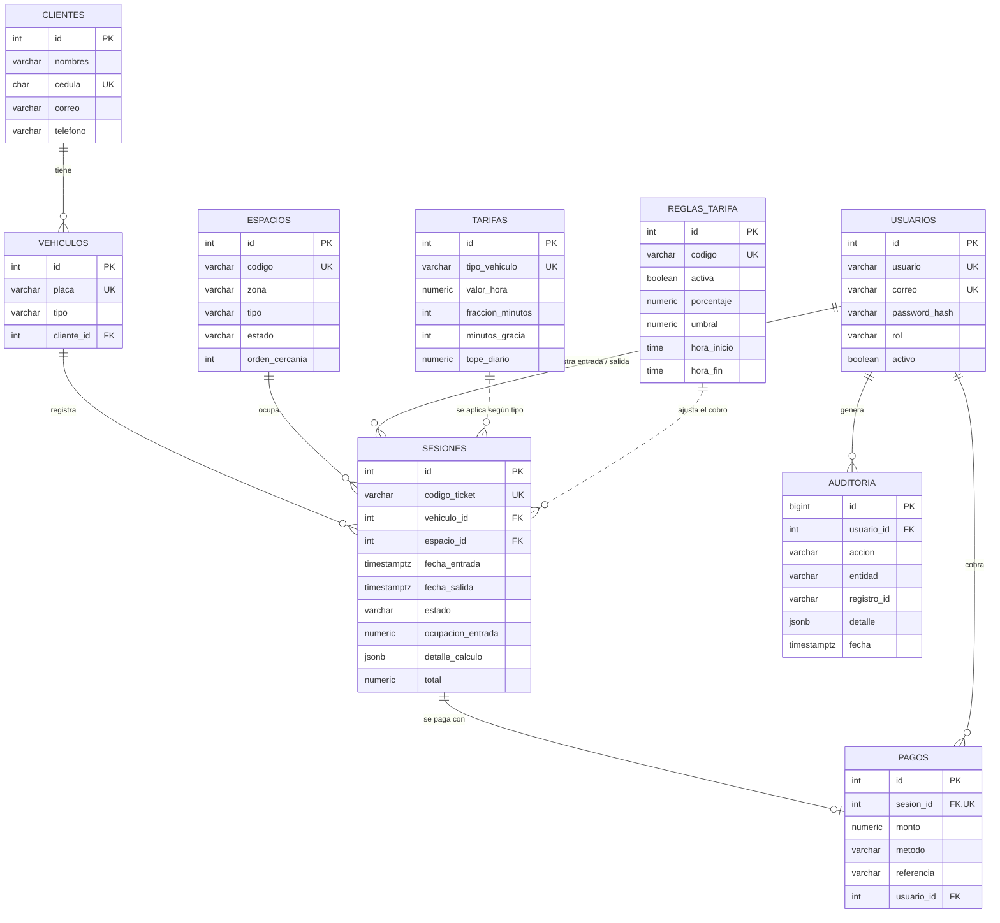

# Modelo de datos · SmartPark

## Relaciones

| Relación | Cardinalidad | Explicación |
|---|---|---|
| Cliente → Vehículo | 1 : N | Un cliente puede tener varios vehículos. El vehículo puede no tener cliente (cliente ocasional, identificado solo por la placa). |
| Vehículo → Sesión | 1 : N | Cada visita al estacionamiento es una sesión. El historial permite detectar clientes frecuentes. |
| Espacio → Sesión | 1 : N | Un espacio tiene muchas sesiones en el tiempo, pero **solo una abierta** a la vez. |
| Sesión → Pago | 1 : 0..1 | Una sesión cerrada tiene exactamente un pago (`UNIQUE sesion_id`): evita cobros duplicados. |
| Usuario → Sesión / Pago / Auditoría | 1 : N | Queda registrado qué guardia registró la entrada, quién cobró y quién hizo cada cambio. |

## Restricciones importantes

- `uq_sesion_abierta_vehiculo`: índice **único parcial** `(vehiculo_id) WHERE estado = 'ABIERTA'`.
- `uq_sesion_abierta_espacio`: índice **único parcial** `(espacio_id) WHERE estado = 'ABIERTA'`.
- `chk_salida_posterior`: la fecha de salida no puede ser anterior a la de entrada.
- `CHECK` en los estados, los roles, los tipos de vehículo y los rangos de las tarifas.
- `ON DELETE SET NULL` en `vehiculos.cliente_id`: si se elimina un cliente, su historial se conserva.
